# Tarea 2: Adquisición con BME688 y procesamiento local en ESP32

CC5328-1 Sistemas Embebidos y Sensores, Universidad de Chile, semestre 2026-2.

**Integrantes:** Pablo Carrasco, Patricio Astorga

**Video de demostración:** _completar con el enlace directo, o ver `video_demostracion.mp4`_

---

## Contenido

1. [Resumen del sistema](#1-resumen-del-sistema)
2. [Estructura del repositorio](#2-estructura-del-repositorio)
3. [Montaje y conexión física](#3-montaje-y-conexión-física)
4. [Firmware ESP32](#4-firmware-esp32)
5. [Aplicación de escritorio](#5-aplicación-de-escritorio)
6. [Protocolo serial](#6-protocolo-serial)
7. [Decisiones de diseño](#7-decisiones-de-diseño)
8. [Pruebas](#8-pruebas)
9. [Capturas](#9-capturas)

---

## 1. Resumen del sistema

```
 BME688  ──I2C──►  ESP32 (ESP-IDF)  ──USB serial──►  PC (Python / PyQt6)
 T, H, P           lectura forzada                    controles
                   media movil de T                   graficos T/H/P
                   deteccion de picos                 eventos y estado
```

- El ESP32 lee temperatura, humedad y presión del BME688 en modo forzado (sin gas ni calefactor).
- La frecuencia de muestreo (0,5, 1, 2 o 5 Hz) y las variables transmitidas se cambian desde la GUI sin reiniciar la placa.
- La media temporal y la detección de picos de temperatura se calculan **en el ESP32**. El PC solo recalcula el promedio para validarlo y lo muestra como "Validación PC".
- La comunicación usa JSON por línea (JSON Lines) en ambos sentidos. Cada comando recibe un `ack` o un `error`.

## 2. Estructura del repositorio

```
esp32_firmware/
  CMakeLists.txt
  sdkconfig.defaults        tick de 1 ms y logs al minimo
  main/
    main.c                  tareas de adquisicion y de comandos
    bme688.c/.h             driver I2C del sensor (T, H, P)
    processing.c/.h         media movil temporal, detector de picos y autotest
    protocol.c/.h           validacion de comandos y armado de mensajes
    mini_json.c/.h          parser JSON pequeño, sin memoria dinamica
    app_config.h            estructura de configuracion
    Kconfig.projbuild       pines I2C y baudrate configurables
gui_python/
  app.py                    punto de entrada
  main_window.py            interfaz
  serial_worker.py          hilo de lectura/escritura serial
  protocol.py               mensajes y calculos de validacion
tests/
  host_c/                   pruebas en C de la logica del firmware (corren en el PC)
  test_protocol.py          pruebas del lado Python (pytest)
tools/
  verificar_log.py          analiza un CSV de la GUI (periodo, promedio, picos)
requirements.txt
```

`processing.c`, `protocol.c` y `mini_json.c` no dependen de ESP-IDF. Por eso el mismo código que corre en la placa se compila en el PC y se prueba con series conocidas.

## 3. Montaje y conexión física

| BME688   | ESP32_DevKitc_V4 (módulo ESP32-WROOM-32D) | Nota                                   |
|----------|--------------|----------------------------------------|
| VCC/VIN  | 3V3          | no usar 5 V si el módulo no tiene regulador |
| GND      | GND          |                                        |
| SDA      | GPIO 21      | configurable en `menuconfig`           |
| SCL      | GPIO 22      | configurable en `menuconfig`           |
| SDO      | GND o 3V3    | define la dirección: GND = 0x76, 3V3 = 0x77 |
| CS       | 3V3          | solo en módulos que lo exponen; en alto selecciona I2C |

- El firmware busca el sensor primero en 0x77 y luego en 0x76, así que no hay que cambiar el código según el módulo.
- Se activan los pull-up internos del ESP32. La mayoría de los módulos ya trae resistencias de pull-up; si el cable es largo conviene que las tenga.
- Bus I2C a 100 kHz (configurable).

_Completar: modelo exacto de placa y módulo usados, y foto del montaje en la sección 9._

## 4. Firmware ESP32

### Requisitos

- ESP-IDF **5.2 o superior** (usa el driver `i2c_master`). Se compiló sin warnings con ESP-IDF v5.4.1.
- Placa ESP32 cuyo USB pase por un conversor USB-serial (CP210x, CH340, etc.) conectado a UART0, como el ESP32 DevKitC. Si la placa usa el USB nativo (USB-Serial-JTAG, por ejemplo en algunas ESP32-S3/C3), hay que cambiar `SERIAL_PORT` en `main.c`.

### Compilar y grabar

```bash
cd esp32_firmware
idf.py set-target esp32
idf.py menuconfig          # opcional: "Tarea 2 - BME688" para cambiar pines o baudrate
idf.py build
idf.py -p /dev/ttyUSB0 flash
```

En Windows el puerto es del tipo `COM5`. Para ver la salida cruda se puede usar `idf.py -p PUERTO monitor`, pero hay que cerrarlo antes de abrir la GUI, porque el puerto no se puede compartir.

### Organización

- **Tarea `sensor`** (prioridad 5): en cada periodo dispara una medición, actualiza el historial de temperatura, calcula la media y el detector de picos, y envía los paquetes. Espera hasta el siguiente periodo con `ulTaskNotifyTake`, de modo que un cambio de configuración recalcula el plazo de inmediato sin reiniciar.
- **Tarea `cmd`** (prioridad 6): arma líneas desde la UART, valida cada comando y, si es válido, reemplaza la configuración completa bajo un mutex.
- Las escrituras a la UART están protegidas por otro mutex para que un `ack` nunca quede intercalado dentro de un `sample`.

## 5. Aplicación de escritorio

### Instalación

```bash
python -m venv .venv
source .venv/bin/activate        # Windows: .venv\Scripts\activate
pip install -r requirements.txt
```

### Ejecución

```bash
cd gui_python
python app.py
```

En Linux, si el puerto da error de permisos: `sudo usermod -aG dialout $USER` y volver a iniciar sesión.

### Qué ofrece la interfaz

- **Conexión:** lista de puertos, baudrate, conectar/desconectar, estado del puerto, del dispositivo y del sensor, y aviso cuando no llegan datos.
- **Adquisición:** frecuencia y casillas independientes de Temperatura, Humedad y Presión. Con las tres desmarcadas, el botón de envío se desactiva.
- **Procesamiento en el ESP32:** activar/desactivar promedio y picos, ventana W (atajos 5, 10, 30 y 60 s), umbral θ con resolución de 0,1 °C e histéresis.
- **Configuración confirmada:** muestra lo que el ESP32 respondió en su `ack`, no lo que hay en los controles. Si no llega respuesta en 2 s, se indica.
- **Valores y gráficos:** T, H y P con unidades. Las variables no transmitidas aparecen como "no transmitida". El gráfico de T muestra además el promedio del ESP32, la línea del umbral y los picos.
- **Validación PC:** promedio recalculado en el PC con la temperatura recibida y su diferencia con el del ESP32. Solo sirve para validar.
- **Eventos de pico:** tabla con número, hora, instante en el ESP32, valor y umbral.
- **Robustez:** la lectura serial corre en un hilo aparte. Si se pierde el puerto se intenta reconectar cada 2 s, y si el ESP32 reinicia se le reenvía la configuración de la GUI.
- **Pruebas:** autotest en la placa, envío de una configuración inválida, envío de texto libre y registro de la sesión en CSV (`gui_python/logs/`).

## 6. Protocolo serial

- 115200 baudios, 8N1. Un mensaje JSON por línea, terminado en `\n`. Líneas de hasta 255 bytes.
- Todo mensaje tiene un campo `type`. La GUI ignora las líneas que no son JSON (por ejemplo, los mensajes de arranque de la ROM).
- Los comandos pueden traer un `id` (letras, números, `_` o `-`) que se devuelve en la respuesta para asociarla.
- Un comando se valida completo antes de aplicarse. Si cualquier campo es inválido se responde `error` y **la configuración no cambia**, ni siquiera en parte.

### GUI → ESP32

| `type`       | Campos                                                                  | Respuesta |
|--------------|-------------------------------------------------------------------------|-----------|
| `config`     | cualquier subconjunto de `sampling_hz`, `variables`, `average`, `peak`  | `ack` con la configuración completa, o `error` |
| `get_config` | —                                                                        | `ack` + `status` |
| `start`      | —                                                                        | `ack` (reanuda la transmisión) |
| `stop`       | —                                                                        | `ack` (detiene la transmisión; la adquisición y el procesamiento siguen) |
| `selftest`   | —                                                                        | `selftest` |
| `ping`       | —                                                                        | `pong` |

Campos de `config`:

| Campo                | Tipo                  | Valores válidos |
|----------------------|-----------------------|-----------------|
| `sampling_hz`        | número                | 0.5, 1, 2, 5 |
| `variables`          | arreglo               | uno o más de `"T"`, `"H"`, `"P"`; vacío no se acepta |
| `average.enabled`    | bool                  | |
| `average.window_s`   | entero                | 1 a 120 (W = 5, 10, 30 y 60 incluidos) |
| `peak.enabled`       | bool                  | |
| `peak.threshold_c`   | número                | -40 a 85, se redondea a 0,1 °C |
| `peak.hysteresis_c`  | número                | 0 a 5 (0 desactiva la histéresis) |

Ejemplo:

```json
{"type":"config","id":"c7","sampling_hz":2,"variables":["H","P"],"average":{"enabled":true,"window_s":30},"peak":{"enabled":true,"threshold_c":28.0,"hysteresis_c":0.3}}
```

### ESP32 → GUI

| `type`     | Cuándo | Campos principales |
|------------|--------|--------------------|
| `hello`    | al arrancar | `fw`, `version`, `t_ms` |
| `status`   | al iniciar o perder el sensor, y tras `get_config` | `sensor` (`ok`/`error`), `addr`, `variant` o `detail` |
| `ack`      | comando aceptado, y al arrancar con `cmd:"boot"` | `cmd`, `id`, configuración completa vigente |
| `error`    | comando rechazado | `code`, `field`, `msg`, `id` |
| `sample`   | cada periodo de muestreo | `seq`, `t_ms`, `valid`, variables seleccionadas y promedio |
| `peak`     | al confirmar un máximo local | `peak_seq`, `t_ms` (muestra pico), `detected_ms`, `peak_c`, `threshold_c` |
| `selftest` | respuesta a `selftest` | resultados sobre series conocidas y `status` |
| `pong`     | respuesta a `ping` | `t_ms` |

Campos de `sample`:

| Campo                 | Presente si…                     | Unidad |
|-----------------------|----------------------------------|--------|
| `seq`                 | siempre (+1 por cada adquisición) | |
| `t_ms`                | siempre (reloj del ESP32 desde el arranque) | ms |
| `valid`               | siempre | |
| `error`               | `valid` es false (`read_failed`, `sensor_not_ready`) | |
| `temperature_c`       | T seleccionada y lectura válida | °C |
| `humidity_pct`        | H seleccionada y lectura válida | %HR |
| `pressure_hpa`        | P seleccionada y lectura válida | hPa |
| `temp_avg_c`          | promedio activo y lectura válida, **aunque T no esté seleccionada** | °C |
| `avg_n`               | junto con `temp_avg_c` | muestras en la ventana |
| `avg_window_s`        | junto con `temp_avg_c` | s |
| `avg_window_complete` | junto con `temp_avg_c` | false mientras no haya pasado W desde la primera muestra |

Ejemplos reales:

```json
{"type":"sample","seq":145,"t_ms":73210,"valid":true,"humidity_pct":40.12,"pressure_hpa":1012.70,"temp_avg_c":26.100,"avg_n":10,"avg_window_s":10,"avg_window_complete":true}
{"type":"sample","seq":146,"t_ms":74210,"valid":false,"error":"read_failed"}
{"type":"peak","peak_seq":1,"t_ms":75410,"detected_ms":75910,"peak_c":28.70,"threshold_c":28.0}
{"type":"error","code":"invalid_value","id":"bad3","field":"sampling_hz","msg":"valores permitidos: 0.5, 1, 2, 5"}
```

Códigos de error: `parse_error` (JSON mal formado), `missing_field`, `unknown_field`, `invalid_value`, `unknown_command`, `line_too_long`.

## 7. Decisiones de diseño

### Adquisición

- Modo forzado: en cada periodo se dispara una conversión y se espera el tiempo calculado como en la API de Bosch (oversampling T×2, P×4, H×1, unos 20 ms), revisando además el bit `new_data`. Con 5 Hz el periodo es de 200 ms, así que hay holgura de sobra.
- El calefactor de gas queda apagado (`ctrl_gas_0 = 0x08`) y no se pide medición de gas.
- La compensación usa las fórmulas en punto flotante de la BME68x SensorAPI con los coeficientes de calibración de cada sensor.
- Filtro IIR desactivado, para que un máximo local no quede retrasado ni aplanado.
- La temperatura se redondea a 0,01 °C antes de procesarla. Así el ESP32 procesa exactamente los mismos valores que transmite, y el PC puede reproducir los cálculos.

### Lecturas inválidas y fallos del sensor

- Si falla la comunicación I2C, la conversión no termina o el valor queda fuera del rango del datasheet (T de -40 a 85 °C, P de 300 a 1100 hPa), se envía `valid:false` con el motivo y **sin valores**. Nunca se manda un número inventado.
- Tras 3 lecturas fallidas seguidas, el sensor se marca como no disponible y se reintenta la inicialización cada 2 s. El cambio de estado se informa con un mensaje `status`.
- Una lectura inválida reinicia el detector de picos, porque se rompe la continuidad de las tres muestras.

### Adquisición y transmisión son cosas distintas

El sensor siempre entrega T, H y P en cada conversión. La máscara `variables` solo decide qué campos se escriben en el `sample`. La temperatura entra al historial y al detector aunque no se transmita, así que con solo H y P seleccionadas siguen llegando `temp_avg_c` y los eventos `peak`.

### Media temporal

- Se guarda un historial circular de (t_ms, T) que siempre cubre los últimos 120 s (650 posiciones, suficiente para 5 Hz). La media usa todas las muestras con `t − W < tᵢ ≤ t`.
- Como el historial no depende de W, al cambiar la ventana (por ejemplo de 5 a 30 s) el resultado se recalcula de inmediato con las muestras ya guardadas.
- `avg_window_complete` es false mientras no haya transcurrido W desde la primera muestra válida, y `avg_n` dice cuántas muestras entraron.

### Detección de picos

Criterio para tres muestras válidas consecutivas:

```
T(k-1) > T(k-2)   y   T(k-1) ≥ T(k)   y   T(k-1) ≥ θ
```

- El pico se confirma al llegar la muestra k. El evento informa el instante de la muestra pico (`t_ms`) y el de confirmación (`detected_ms`).
- Superar θ no basta: una subida continua sobre el umbral no genera eventos, porque no hay máximo local.
- **No se repite el mismo pico:** la condición estricta `T(k-1) > T(k-2)` hace que una meseta (28,3; 28,3; 28,3) genere un solo evento, en su primera muestra.
- **Histéresis contra detecciones espurias:** el sensor tiene resolución de 0,01 °C, así que cerca de un máximo aparecen pequeños vaivenes que serían "picos" distintos. Después de un evento, el detector se desarma hasta que T baja de θ − h (h = 0,3 °C por defecto). Así cada vez que la temperatura sube sobre el umbral se reporta un solo evento. Con h = 0 se reporta todo máximo local.
- Cambiar θ o h, o reactivar la detección, reinicia el detector.

Se verificó con esta serie conocida (una muestra por segundo, θ = 28,0 °C):

```
27.0 27.4 28.2 28.6 28.4 28.1 27.6 27.9 28.3 28.3 28.2 27.5 29.0 29.1 29.1 29.2 28.0
```

- Con h = 0,3: 3 eventos (28,6 en t = 3 s; 28,3 en t = 8 s; 29,1 en t = 13 s). El 29,2 no se reporta porque la temperatura no bajó de 27,7 desde el pico anterior.
- Con h = 0: 4 eventos (se suma 29,2 en t = 15 s).
- En ambos casos la meseta 28,3 / 28,3 da un único evento.

Esta misma serie la corre el comando `selftest` en la placa y las pruebas del PC.

### Configuración consistente

El parser trabaja sobre una copia de la configuración. Solo si todos los campos son válidos se reemplaza la configuración completa en una sola operación protegida por mutex, se avisa a la tarea del sensor y se responde con un `ack` que trae el estado completo. La GUI muestra como vigente solo lo que viene en ese `ack`.

### GUI no bloqueante

La lectura serial corre en un `QThread` que emite una señal por línea. La interfaz nunca espera al puerto. Un timer revisa cada 0,5 s si llegan datos: si pasan más de 3 periodos (mínimo 3 s) sin un `sample`, avisa que no hay información.

## 8. Pruebas

### 8.1 Pruebas automáticas

```bash
# lógica del firmware compilada en el PC (media, picos, parser, mensajes)
cd tests/host_c && make

# lado Python
python -m pytest tests
```

En la placa, el botón **Autotest ESP32** (o el comando `{"type":"selftest"}`) corre las mismas series conocidas sobre el código del firmware y responde con los resultados.

### 8.2 Verificación con un registro de la GUI

Activar "Guardar sesión en CSV", hacer la prueba y luego:

```bash
python tools/verificar_log.py gui_python/logs/sesion_AAAAMMDD_HHMMSS.csv --theta 28.0 --hyst 0.3
```

El script muestra la distribución de periodos entre paquetes consecutivos, compara cada `temp_avg_c` del ESP32 con el promedio recalculado (tolerancia 0,006 °C, por el redondeo de transmisión) y recalcula los picos con el mismo criterio.

### 8.3 Pruebas experimentales

| # | Prueba | Procedimiento | Resultado esperado |
|---|--------|---------------|--------------------|
| 1 | Lecturas reales | T, H y P seleccionadas a 1 Hz | valores plausibles con unidades |
| 2 | Siete combinaciones | enviar cada combinación y revisar los campos del `sample` | solo llegan las variables marcadas |
| 3 | Cambio de frecuencia | 1 Hz → 5 Hz sin reiniciar; CSV + `verificar_log.py` | periodos de ~1000 ms y luego ~200 ms, `seq` sin saltos |
| 4 | Ventana Incompleta | W de 5 s → 30 s | error máximo ≤ 0,006 °C; ventana incompleta antes de cumplir 30 s |
| 5 | Picos | θ cerca de la T ambiente; calentar suavemente con la mano/aliento | un solo evento por subida; autotest OK |
| 6 | T oculta | seleccionar solo H y P con promedio y picos activos | siguen llegando `temp_avg_c` y `peak` |
| 7a | Comando inválido | botón "Enviar config inválida" (`sampling_hz: 3`) | `error` con campo `sampling_hz`; la config confirmada no cambia |
| 7b | Desconexión | desenchufar el USB y volver a conectarlo | la GUI avisa, reintenta, reconecta y reenvía la config |

#### Resultados
##### Prueba 1: Lecturas reales
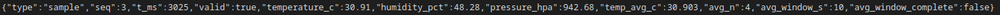

##### Prueba 2: Siete Combinaciones

| T | H | P | Campos recibidos en `sample` | OK |
|---|---|---|------------------------------|----|
| ✓ | – | – | `temperature_c` | |
| – | ✓ | – | `humidity_pct` | |
| – | – | ✓ | `pressure_hpa` | |
| ✓ | ✓ | – | `temperature_c`, `humidity_pct` | |
| ✓ | – | ✓ | `temperature_c`, `pressure_hpa` | |
| – | ✓ | ✓ | `humidity_pct`, `pressure_hpa` | |
| ✓ | ✓ | ✓ | las tres | |

La selección vacía se impide en la GUI (botón desactivado) y, si se envía a mano, el ESP32 responde `invalid_value` en `variables`.

T:
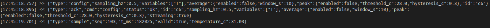
H:
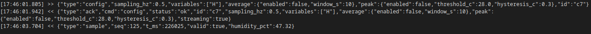
P:

T, H:

T, P:
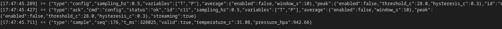
H, P:
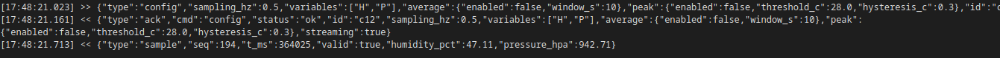
T, H, P:
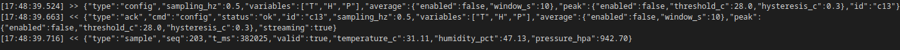

##### Prueba 3: Cambio de frecuencia
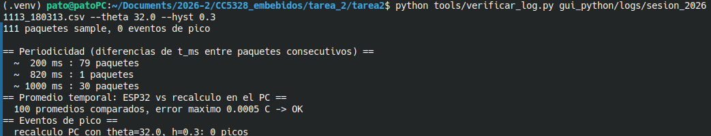

##### Prueba 4: Ventana Incompleta
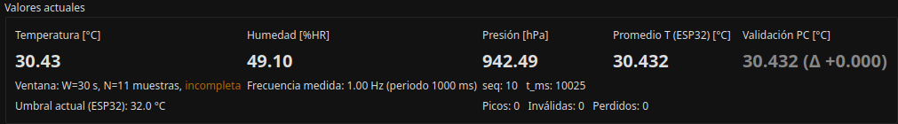

##### Prueba 5: Picos
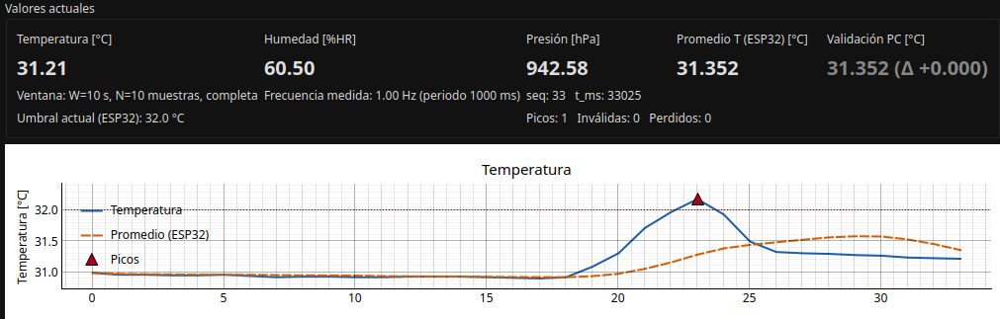

##### Prueba 6: T° Oculta
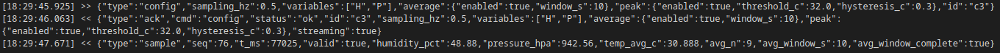

##### Prueba 7a: Comando inválido
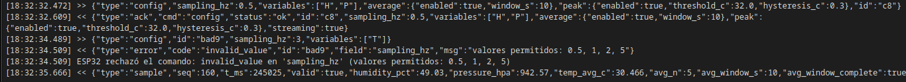

##### Prueba 7b: Desconexión
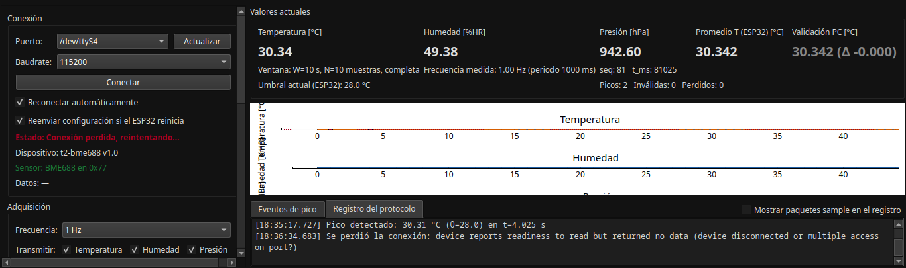
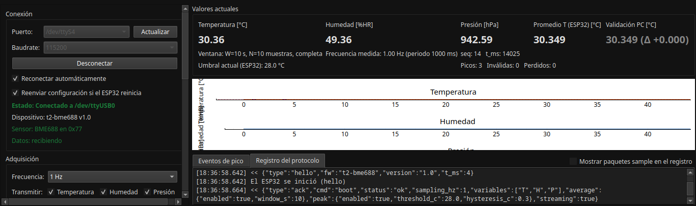


## 9. Capturas

### Montaje BME688–ESP32:
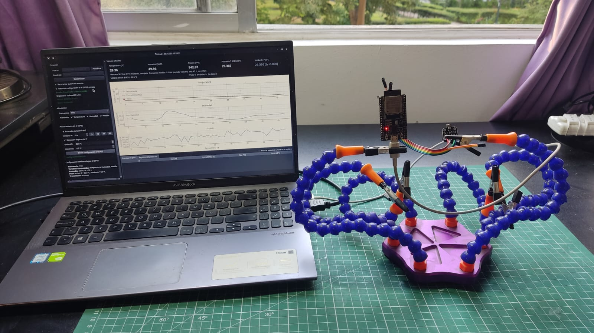

### GUI mostrando 3 variables:
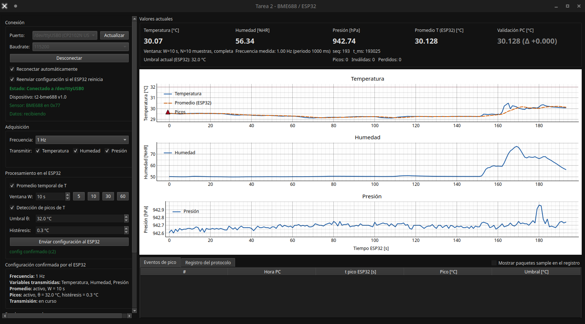

### GUI con T oculta mostrando promedio y picos:
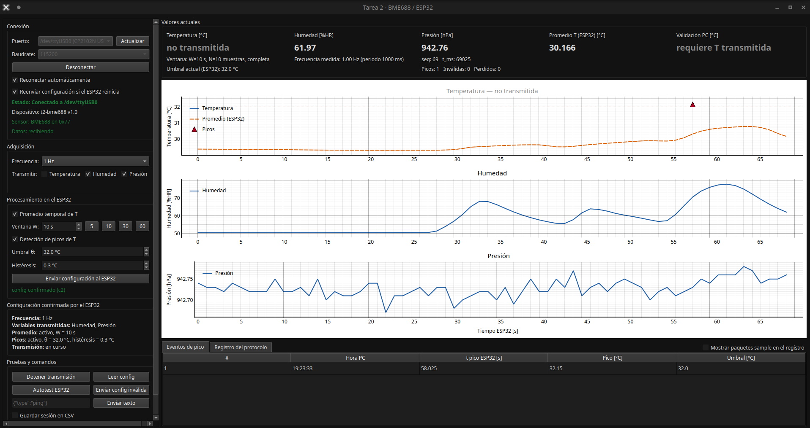

### GUI con rechazo de comando inválido:
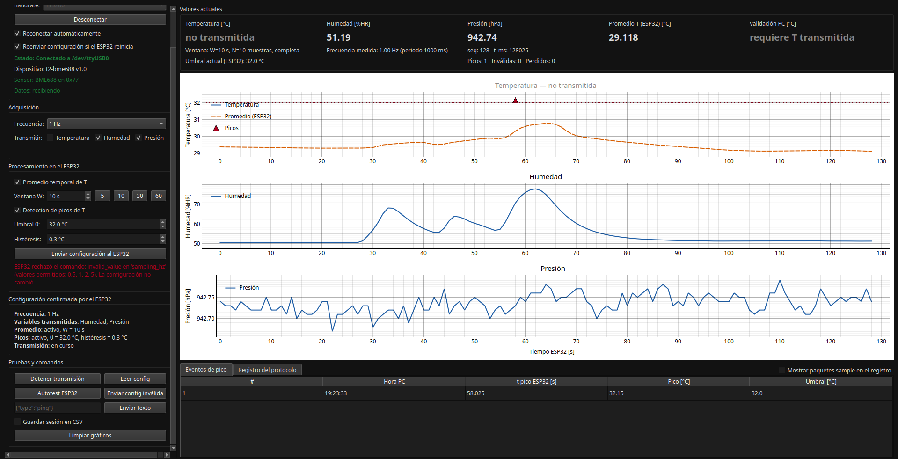
